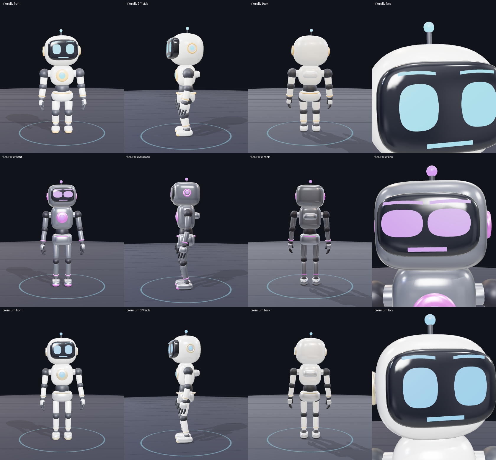
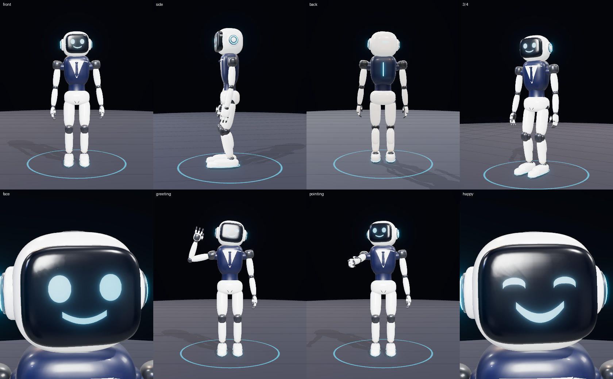
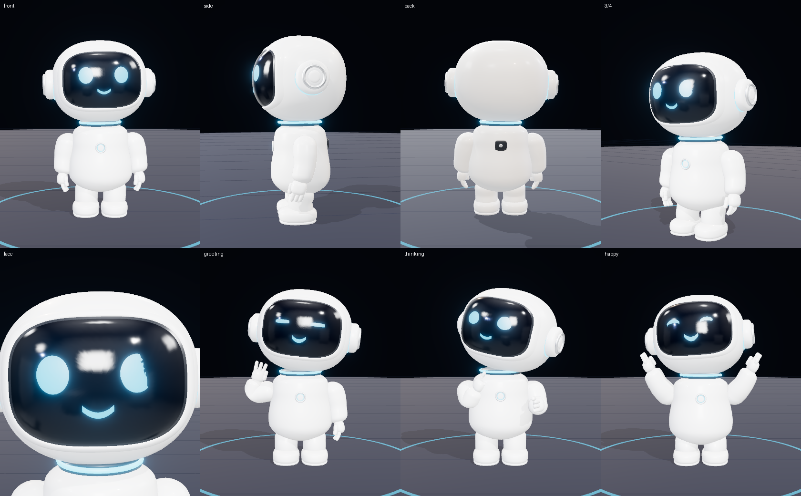
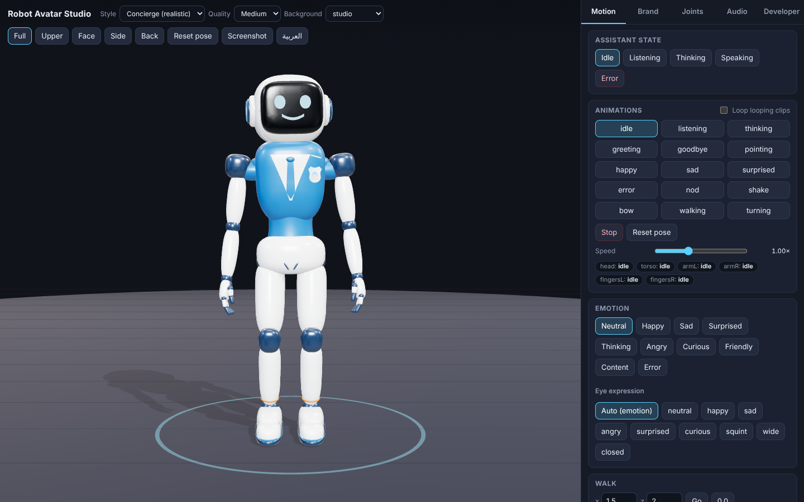

# Robot Avatar Engine

A reusable platform for a **real, rigged, programmable 3D AI-assistant robot** on the web:
Blender-built character (skeleton, shape keys, PBR) → GLB → a TypeScript engine on top of three.js
(animation layers, IK locomotion, facial expressions, lip-sync, state machine, JSON/WebSocket control) →
a **Control Studio** to test everything.

> **بالعربية:** منصة لشخصية روبوت ثلاثية الأبعاد حقيقية (مجسم + هيكل عظمي + Shape Keys) تُبنى بـ Blender وتُشغَّل بمحرك TypeScript فوق three.js.
> كل أمر في الـAPI (`playAnimation`, `setEmotion`, `moveHead`, `moveArm`, `walkTo`, `speak`…) يحرّك عظامًا أو Morph Targets حقيقية، وليس كاميرا أو صورة.
> التقرير البحثي: [`docs/RESEARCH.ar.md`](docs/RESEARCH.ar.md) · التصميم: [`docs/DESIGN.md`](docs/DESIGN.md) · لوحة التحكم تدعم العربية (RTL).


*Three stylised variants from the same rig (friendly / futuristic / premium).*



*New **Mascot**: 92 cm chibi assistant (helmet head with inset glossy visor + cyan face, silver headphone pods, glowing neck ring, chest emblem/logo spot, chubby fingers).*

*New **Concierge**: receptionist robot redesigned after the reference sheet (rounded helmet with black visor + cyan LED face, headphone pods, navy vest over white shirt and tie, gold medallion, charcoal joints, cyan-lined shoes). Default in the Studio — see [docs/DESIGN.md](docs/DESIGN.md) for an honest comparison with photo-realistic concepts.*



**Environment:** the Studio opens in a procedural reception **lobby** (polished stone floor, walnut slat feature wall with a backlit sign, reception desk, glass wall with daylight, plants, downlights). Reflections on the robot come from the room itself. Switch with *Background* (`lobby`, `studio`, `light`, ...) or `viewer.setBackground("lobby")`.

## تشغيل سريع على جهازك (localhost)

1. ثبّت [Node.js](https://nodejs.org) (الإصدار 20 أو أحدث) ونزّل المشروع (`git clone` ثم `git checkout claude/awesome-noether-ve29yd`، أو Download ZIP).
2. **ويندوز:** انقر مرتين على `run-local.bat` — **ماك/لينكس:** `./run-local.sh`.
3. سيفتح المتصفح على **http://localhost:5173** (أول مرة يثبّت الحزم تلقائيًا).

## Quick start

```bash
npm install
npm run dev            # Control Studio at http://localhost:5173
npm test               # 102 unit/integration tests (headless, real GLB models)
npm run test:e2e       # 28 browser tests (Chromium + WebGL): Studio, audio lip-sync, WebSocket, R3F
npm run build          # type-check + production build (dist/)
```

Rebuilding the character (optional — the GLBs are committed):

```bash
pip install bpy numpy          # Blender as a Python module (3.11–3.13)
npm run model:build            # blender/build_robot.py -> assets/models/*.blend + public/models/*.glb (Meshopt)
```

## Use it in your app (no UI dependency)

```ts
import { RobotAvatar, RobotViewer } from "./src";

const viewer = new RobotViewer(document.getElementById("stage")!, { quality: "high" });
const robot = await RobotAvatar.load("/models/robot_premium.glb");
viewer.add(robot);
viewer.start();

robot.playAnimation("greeting");
robot.setEmotion("happy");
robot.lookAt({ x: 0, y: 1.4, z: 2 });
robot.moveHead({ yaw: 20, pitch: 10, roll: 0 });
robot.moveArm("right", { shoulder: 30, elbow: 45, wrist: 10 });
await robot.walkTo({ x: 2, z: 3 });
robot.speak({ text: "Hello!", lipSync: true, emotion: "friendly" });   // or { audioUrl: "/audio/hello.wav" }
robot.stop();
robot.resetPose();
```

Every call above is wired to real bones / morph targets and covered by tests ([docs/API.md](docs/API.md)).
Remote control: JSON commands ([docs/COMMANDS.md](docs/COMMANDS.md)) over WebSocket (`attachBridge`, `connectWebSocket`).
Works with plain three.js ([examples/minimal.html](examples/minimal.html)) and React Three Fiber ([examples/r3f](examples/r3f/main.tsx)).

## What's inside

| Layer | Where | Doc |
|---|---|---|
| Research & decisions | `docs/RESEARCH.ar.md` | technology comparison with sources |
| Character design | `blender/build_robot.py`, `assets/models/` | [docs/DESIGN.md](docs/DESIGN.md) |
| Rig (40 bones, 43 morph targets: 19 mouth/visemes, 2×8 eyes, 2×4 brows) | `src/engine/rig.ts` | [docs/RIG.md](docs/RIG.md) (generated) |
| Animation system | `src/engine/{clips,library,AnimationController}.ts` | [docs/ANIMATION.md](docs/ANIMATION.md), [docs/MOTIONS.md](docs/MOTIONS.md) (every clip) |
| **JSON motions (AI-authorable)** | `src/engine/motionJson.ts` | [docs/MOTION_AUTHORING.md](docs/MOTION_AUTHORING.md), [schema](docs/motion.schema.json) |
| **Remote HTTP/WebSocket API** | `tools/remote_api_server.mjs`, `src/engine/{commands,bridge}.ts` | [docs/REMOTE_API.md](docs/REMOTE_API.md) |
| Face + lip-sync | `src/engine/{FaceController,lipsync/*}` | [docs/LIPSYNC.md](docs/LIPSYNC.md) |
| IK locomotion, gaze, joint overrides | `src/engine/{LocomotionController,ik,GazeController,JointOverrides}.ts` | [docs/ANIMATION.md](docs/ANIMATION.md) |
| Robot API, state machine, JSON bridge | `src/engine/{RobotAvatar,stateMachine,commands,bridge}.ts` | [docs/API.md](docs/API.md), [docs/COMMANDS.md](docs/COMMANDS.md) |
| Viewer (quality tiers, camera) | `src/viewer/RobotViewer.ts` | [docs/PERFORMANCE.md](docs/PERFORMANCE.md) |
| Control Studio | `src/studio/` | [docs/STUDIO.md](docs/STUDIO.md) |
| **Ask a question → the robot answers (Gemini)** | `src/engine/assistant.ts`, `examples/gemini/` | [docs/GEMINI.md](docs/GEMINI.md) |
| Tests | `tests/` | [docs/TESTING.md](docs/TESTING.md) |
| Integration guide | | [docs/INTEGRATION.md](docs/INTEGRATION.md) |

## Honest limitations (read before shipping)

- **Lip-sync precision.** Text-based visemes are rule-based approximations (English/Arabic spelling → mouth shapes), audio analysis recognises *vowel shapes and openness*, not phonemes. For letter-accurate sync feed real viseme/word timings from your TTS ([adapters](docs/LIPSYNC.md)). Measured results and the exact test conditions are in [docs/TESTING.md](docs/TESTING.md); they were obtained with **synthetic formant audio**, not recorded human speech.
- **Browsers/devices.** Automated tests ran in Chromium (software WebGL) only. Firefox, Edge, Safari and real phones were **not** tested in this environment; the code uses standard WebGL2 + Web Audio APIs. GPU frame rates were not measured (no GPU available); see [docs/PERFORMANCE.md](docs/PERFORMANCE.md) for the budget analysis.
- **Character art.** The model is procedurally modelled from code (rounded superellipsoid primitives, tori), deliberately stylised. It is a clean, rigged, production-structured base, not hand-sculpted artist-grade art; the `.blend` files are the editable source.
- **Animation.** Built-in motions are procedural/keyframed in code (editable, data-driven), not mocap. Walking is a procedural IK gait with foot planting, not a motion-capture cycle.
- **Browser TTS.** `speechSynthesis` exposes no audio stream, so with it the mouth follows a text timeline re-synced on `boundary` events (when the voice emits them); voices and boundary support vary per OS/browser and none were available in the test environment (silent preview path tested instead).
- WebGPU is not used (WebGL2 only, for reach); see the research report for the trade-off.

## License

MIT for the code in this repository. The robot models are original works generated by `blender/build_robot.py` (same license). Dependencies: three.js (MIT), React (MIT), Blender/`bpy` (GPL, only used to *produce* the GLBs; exported assets are not GPL-encumbered), gltf-transform (MIT), meshoptimizer (MIT). Demo audio is synthesised by `tools/make_test_audio.ts` (no third-party recordings).
